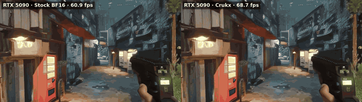

<div align="center">

# crukx-waypoint

**An open benchmark harness for real-time world models. Speed, fidelity, latency and players per GPU,
measured on [Waypoint-1.5](https://huggingface.co/Overworld/Waypoint-1.5-1B) across six NVIDIA GPUs.**



<sub>Waypoint-1.5 at 720p on an RTX 5090, same seed world and the same human-like inputs. Left: stock BF16, 60.9 fps. Right: with Crukx, 68.7 fps.
The paths drift apart because stock Waypoint does not repeat itself run to run (see <a href="#same-quality-not-same-pixels">below</a>); quality is equal.</sub>

</div>

---

Frame rate alone says little about a generative world model. A faster model can draw a slightly different,
slightly worse world, and an fps counter will never notice. This harness measures what a player gets:

- **Speed.** Frames per second as the player sees them, with Overworld's own benchmark method alongside.
- **Fidelity.** Every configuration is checked against an **FP32 reference** of the same model, seed and inputs. Stock BF16's own error is the budget.
- **Latency.** Time from a key press to the first frame generated from it.
- **Capacity.** How many live players and paused worlds fit on one GPU.

Everything here runs on stock [`world_engine`](https://github.com/Overworldai/world_engine). Pass `--crukx` to measure
the same scripts with [Crukx](https://crukx.dev), our runtime layer for stateful generative models.

## Results

Waypoint-1.5-1B, `world_engine@68b3163`, BF16, Biome seed worlds, measured 30–31 October 2026.
Raw JSON for every number is in [`results/2026-10-31`](results/2026-10-31). The RTX 4090 figures come from an earlier run
of the same methods and are not in that folder.

### Speed at stock quality (720p)

| GPU | Stock BF16 | With Crukx | Change | Crukx kernels |
|---|---:|---:|---:|---|
| RTX 3090 (24 GB) | 21.6 fps | **26.1 fps** | **+21%** | on |
| RTX 4090 (24 GB) | 52.7 fps | **61.1 fps** | **+16%** | on |
| RTX 5090 (32 GB) | 60.9 fps | **68.7 fps** | **+13%** | on |
| L40S (48 GB) | 62.7 fps | 62.8 fps | 0% | off: stock kept |
| A100 SXM (80 GB) | 46.8 fps | 47.1 fps | 0% | off: stock kept |
| H100 SXM (80 GB) | 123.1 fps | 122.0 fps | 0% | off: stock kept |

Full loop including decode, human-like play. Crukx times its kernels against stock on each GPU at the model's own sizes
and turns them on only where they win. GeForce cards benefit; datacenter cards keep stock and lose nothing.

### Fidelity against an FP32 reference

Median per-frame error and PSNR, *history* test (the model's own past frames, as in play), 720p. Lower error is better.

| | Stock BF16 | With Crukx | Waypoint's INT8 mode |
|---|---:|---:|---:|
| Mixed controls, RTX 3090 | 0.68% · 50.1 dB | 0.67% · 50.2 dB | 3.00% · 42.4 dB |
| Neon alley night, RTX 3090 | 0.88% · 48.4 dB | 0.80% · 48.9 dB | 4.23% · 38.4 dB |
| Highland castle loch, RTX 3090 | 0.93% · 46.6 dB | 0.84% · 47.8 dB | 4.19% · 35.7 dB |
| Mixed controls, RTX 5090 | 0.71% · 50.0 dB | 0.67% · 50.2 dB | |
| Mixed controls, L40S / A100 / H100 | 0.66–0.68% · 50.1–50.3 dB | identical to stock | |

INT8 is the fastest mode (75 fps at 720p on an RTX 4090), at 3–5× BF16's error. It is a useful speed mode with a quality cost,
and this harness measures how large that cost is.

### Key press to pixels (720p, p50 / p95)

| RTX 3090 | RTX 4090 | RTX 5090 | L40S | A100 SXM | H100 SXM |
|---|---|---|---|---|---|
| 289 / 387 → **246 / 319** ms | 121 / 156 → **98 / 133** ms | 100 / 135 → **94 / 124** ms | 104 / 134 ms | 131 / 170 ms | **52 / 71 ms** |

### Players per GPU


<sub>Exact world state (Crukx): one save, two players continue from the same moment. Rewinding and replaying player 1's inputs reproduces every frame bit for bit.</sub>

**Paused worlds held per GPU, resumed bit-exact** (Crukx). A paused world costs no frames.

| | RTX 3090 | RTX 4090 | RTX 5090 | L40S | A100 SXM | H100 SXM |
|---|---:|---:|---:|---:|---:|---:|
| 720p on GPU + in RAM | 7 + 10 | 7 + 5 | 11 + 19 | 17 + 33 | 34 + 23 | **33 + 47** |
| 360p on GPU + in RAM | 32 + 42 | 33 + 18 | 46 + 77 | 69 + 131 | 131 + 92 | **130 + 189** |

Resume takes 7–45 ms from the GPU (A100: up to 120 ms), 17–180 ms from RAM and 3–24 s from disk.
The RAM tier was capped by each test machine's memory allowance, and disk holds any number of worlds.

**Live players on one H100 at 720p.**

| | Live players | Total fps | GPU memory |
|---|---:|---:|---:|
| Stock, one process per player | 8 (memory full) | 120 | 76.6 GB |
| Crukx shared engine, one copy of the model | **32** | 118 | 73.3 GB |

Every shared-engine session hashes frame for frame like the same world played alone. A GPU's total frame rate is
shared by its live players in any setup, so at 60 fps or more per player an H100 serves 2 players at 720p and 3 at 360p.
Idle players add no load.

**Would batching players help?** [`bench/batch_probe.py`](bench/batch_probe.py) times the model's own layers at batch sizes 1–16.
Batching only speeds up the matrix multiplies, so the estimated gain is a ceiling for those layers alone:

| | 720p | 360p |
|---|---:|---:|
| RTX 3090 | ~1.1× | |
| A100 SXM | ~1.2× | ~1.5× |
| H100 SXM | ~1.2× | ~1.7× |

### Same quality, not same pixels

Two stock runs with the same seed and inputs already differ in their first frames and drift apart over time.
Waypoint's optimized path is not run-to-run deterministic, and small numeric differences grow in any model that
feeds its own frames back. So "equal to stock" is measured as equal error against the FP32 reference, never by
comparing two videos. Crukx's exact mode is what makes a run repeat bit for bit.

## Quickstart

Requires an NVIDIA GPU (16 GB or more for 720p), CUDA, Python 3.11 or newer and `ffmpeg`.

```bash
git clone https://github.com/Crukx-dev/crukx-waypoint && cd crukx-waypoint
pip install -r requirements.txt
bash fetch_seeds.sh                          # Biome seed worlds, fetched from Overworld's repository
hf download Overworld/Waypoint-1.5-1B --local-dir models/model720
hf download Overworld/Waypoint-1.5-1B-360P --local-dir models/model360
```

```bash
cd bench
python fps.py --model-dir ../models/model720 --out ../out/fps_stock.json
python latency.py --model-dir ../models/model720 --out ../out/latency_stock.json
python fidelity.py golden  --model-dir ../models/model720 --golden ../out/golden.pt
python fidelity.py history --model-dir ../models/model720 --golden ../out/golden.pt --out ../out/fid_stock.json
python fidelity.py history --model-dir ../models/model720 --golden ../out/golden.pt --out ../out/fid_int8.json --quant intw8a8
python play.py --model-dir ../models/model720 --seeds ../seeds/neon_alley_night.jpg --tag stock --out ../out/play
```

Or run everything that we ran on each GPU:

```bash
bash run_matrix.sh models out        # about 45–60 minutes per GPU, mostly kernel compilation
```

## What is in this repository

| Path | What it measures |
|---|---|
| [`bench/fps.py`](bench/fps.py) | Frames per second, split into prep, denoise, cache and decode |
| [`bench/latency.py`](bench/latency.py) | Key press to pixels, p50, p95 and p99 |
| [`bench/fidelity.py`](bench/fidelity.py) | The fidelity oracle: FP32 reference with isolated, history and free-running tests |
| [`bench/play.py`](bench/play.py), [`bench/controls.py`](bench/controls.py) | Human-like play in Biome worlds, with video, startup and fps |
| [`bench/players.py`](bench/players.py), [`bench/players.sh`](bench/players.sh) | Live players per GPU, one process per player |
| [`bench/batch_probe.py`](bench/batch_probe.py) | Ceiling on what batching players could gain |
| [`bench/sessions.py`](bench/sessions.py), [`bench/fork_demo.py`](bench/fork_demo.py) | Shared engine and exact forks (need `crukx_waypoint`) |
| [`run_matrix.sh`](run_matrix.sh) | All of the above on one GPU |
| [`results/`](results) | Raw results from RTX 3090, RTX 5090, L40S, A100 and H100 |

The harness is open source. `crukx_waypoint` (the kernels, exact state, save store and shared engine behind
`--crukx`) is distributed separately. Every stock measurement here runs without it.

## Related work

Exact, persistent state for interactive models is an active research area:
[CachedAttention](https://arxiv.org/abs/2403.19708) (tiered session state for LLM chat, USENIX ATC 2024),
[TurboServe](https://arxiv.org/abs/2606.19271) (multi-session streaming video serving),
[exact-state serving for interactive world models](https://arxiv.org/abs/2607.10389) (Matrix-Game 2.0) and
[batch-invariant inference](https://github.com/thinking-machines-lab/batch_invariant_ops) (Thinking Machines).

## Notes

- Independent work, not affiliated with or endorsed by Overworld. Waypoint-1.5 and `world_engine` are Overworld's,
  released under Apache-2.0. Biome seed images are downloaded from Overworld's repository and not redistributed here.
- Results apply to `world_engine@68b3163`. Other versions should be re-measured.
- Startup is dominated by kernel compilation: 2.5–9 minutes on a cold cache, and under 2 minutes once the cache is warm.

## License

[Apache-2.0](LICENSE)
